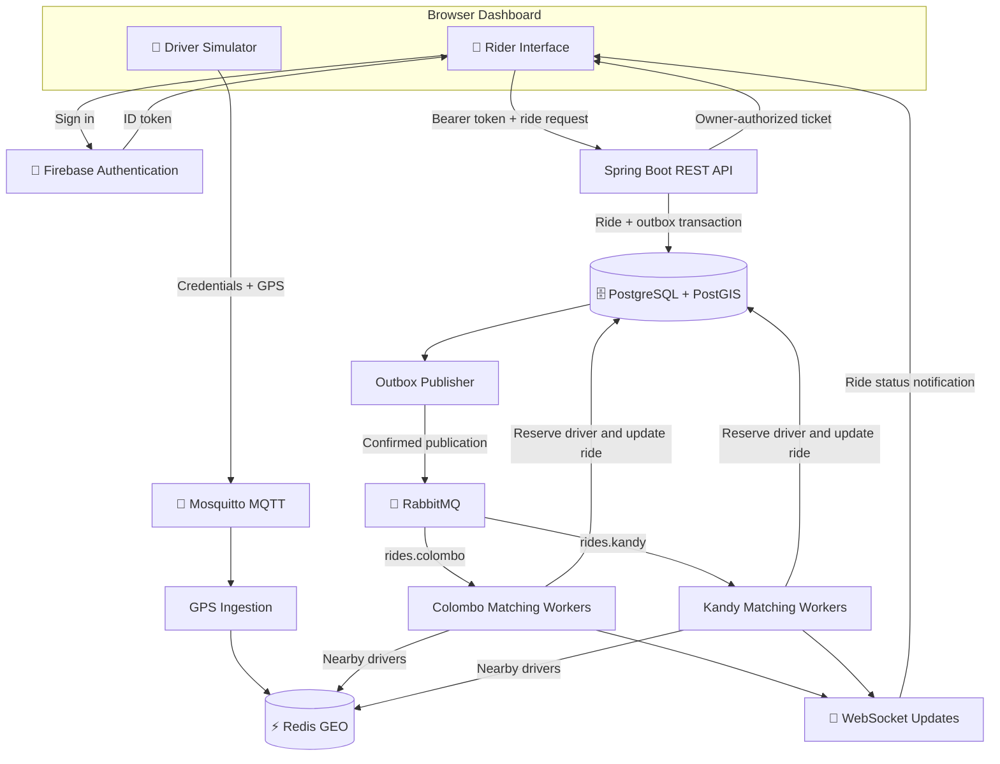
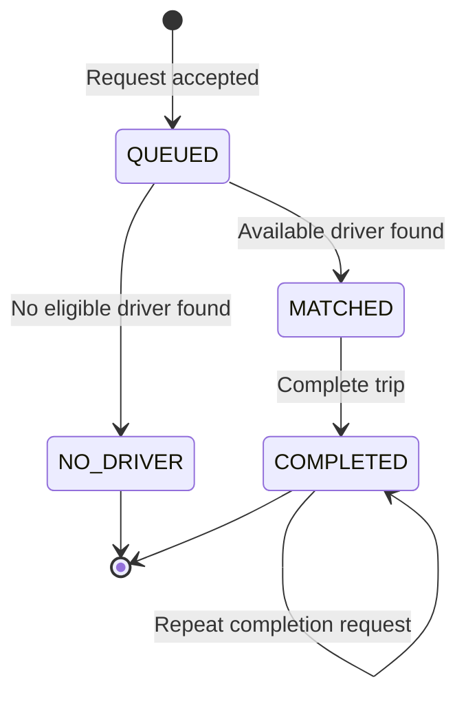

# 🚕 RideFlow

### Event-Driven Ride-Hailing Prototype

RideFlow is a local ride-hailing prototype that processes driver GPS updates and ride requests asynchronously. It combines Firebase authentication, MQTT messaging, city-specific queues, and Redis geospatial matching.

> 🎓 Learning and demonstration project. GPS is simulated, and payments do not charge real money.

---

## ✨ Implemented Features

| Feature                    | Description                                                         |
| -------------------------- | ------------------------------------------------------------------- |
| 🔐 Firebase Authentication | Email/password registration and login with backend JWT verification |
| 📍 Driver GPS Simulator    | Publishes simulated coordinates through authenticated MQTT          |
| 🛡️ MQTT Access Control     | Restricts provisioned drivers to their permitted location topics    |
| 📨 Asynchronous Processing | Buffers ride requests using RabbitMQ                                |
| 🌆 City Queues             | Separate matching queues for Colombo and Kandy                      |
| ⚡ Geospatial Matching     | Searches Redis for nearby drivers within a 5 km radius              |
| ⏱️ Location Freshness      | Excludes driver locations older than 30 seconds                     |
| 🚗 Driver Reservation      | Database constraints prevent simultaneous driver assignments        |
| 🔄 Request Idempotency     | Repeated requests with the same key return the same ride            |
| 📡 Live Updates            | Owner-authorized WebSocket tickets with polling fallback            |
| 💳 Mock Payments           | Repeated payment calls return the existing payment receipt          |
| 🗺️ Trip History            | Stores coarse pickup areas using PostgreSQL and PostGIS             |
| 🔒 Location Minimization   | Clears precise pickup coordinates when a trip is completed          |
| 💾 Ride Restoration        | Restores the selected ride after reloading the same browser tab     |
| 🩺 Health Checks           | Spring Boot Actuator reports infrastructure health                  |

---

## 🏗️ Architecture



### How a ride is processed

1. A provisioned driver publishes GPS coordinates through MQTT.
2. The backend updates the driver's city-specific Redis location and last-seen timestamp.
3. An authenticated rider submits a request with an idempotency key.
4. The backend saves the ride and its outbox event in one database transaction.
5. The outbox publisher sends the event to the appropriate city queue.
6. A matching worker checks nearby, fresh driver locations.
7. The worker reserves an available driver and updates the ride.
8. The dashboard receives a notification and fetches the latest ride status.
9. Completing the ride releases the assignment and archives a coarse pickup area.
10. Mock payment retries return the existing receipt.

---

## 🔄 Ride Lifecycle



Payment is tracked separately from the ride status. A completed ride can receive a `MOCK_SUCCEEDED` payment record.

---

## 🧰 Technology Stack

| Layer                | Technology                                                |
| -------------------- | --------------------------------------------------------- |
| Backend              | Java 17, Spring Boot 4.0.8                                |
| Authentication       | Firebase Authentication, Spring Security JWT verification |
| Driver Messaging     | MQTT, Eclipse Mosquitto, MQTT.js                          |
| Request Queues       | RabbitMQ, Spring AMQP                                     |
| Location Cache       | Redis geospatial indexes                                  |
| Database             | PostgreSQL 16, PostGIS                                    |
| Live Updates         | WebSockets, HTTP polling fallback                         |
| Frontend             | HTML, CSS, JavaScript                                     |
| Local Infrastructure | Docker Desktop, Docker Compose                            |
| Build                | Maven Wrapper                                             |
| Monitoring           | Spring Boot Actuator                                      |

---

## 🚀 Local Setup — Windows PowerShell

### 1. Prerequisites

Install:

- Git
- Java 17 JDK
- Docker Desktop with the WSL 2 backend
- A code editor such as VS Code

A separate Maven installation is unnecessary because the backend includes Maven Wrapper.

### 2. Clone the repository

```powershell
git clone https://github.com/HasinduBimsara/rideflow.git
cd rideflow
```

### 3. Configure Firebase

Use your Firebase project configuration in the frontend authentication files and configure the backend JWT issuer and audience for the same project.

Enable **Email/Password** authentication in Firebase and configure the authorized domains used by your local application.

Firebase browser configuration identifies the project. It is separate from private service-account credentials and MQTT passwords.

### 4. Provision MQTT accounts

The broker uses a local password file:

```text
mosquitto/secrets/passwords
```

This file is ignored by Git and must be provisioned locally before starting the MQTT service.

Create:

- An `ingestion` account for the backend.
- A driver account whose username matches the driver's Firebase UID.

Use `mosquitto_passwd` to generate password hashes. Configure `mosquitto/acl.conf` so:

- `ingestion` can read `drivers/+/+/location`.
- Each driver can write only to its explicitly permitted city and UID topic.

Example driver topic:

```text
drivers/colombo/<FIREBASE_UID>/location
```

> MQTT accounts are provisioned manually. Registering a Firebase account does not automatically create an MQTT account. A fresh clone requires this local provisioning step.

### 5. Start infrastructure

Open Docker Desktop and wait for its engine to start.

```powershell
docker compose up -d
docker compose ps
```

### 6. Start the backend

From the repository root:

```powershell
powershell.exe -NoProfile -ExecutionPolicy Bypass -File .\start-backend.ps1
```

Enter the **ingestion MQTT password** when prompted.

The script checks port `8081`, sets the password for the backend process, enables normal matching listener startup, and launches Spring Boot.

Keep this terminal open. Use `Ctrl + C` to stop the backend.

### 7. Open the dashboard

- Dashboard: http://localhost:8081/
- Login: http://localhost:8081/login.html
- Health: http://localhost:8081/actuator/health

---

## 🎮 Try the Demo

### 📍 Start driver GPS

1. Register or sign in.
2. Enter the MQTT password provisioned for that Firebase UID.
3. Select **Colombo**.
4. Keep the default driver coordinates:
   - Latitude: `6.9271`
   - Longitude: `79.8612`
5. Click **Start GPS**.

The current simulator is configured for Colombo driver publishing. Kandy driver access requires corresponding ACL and simulator configuration changes.

### 🙋 Request a ride

1. Select **Colombo**.
2. Enter pickup coordinates:
   - Latitude: `6.9280`
   - Longitude: `79.8620`
3. Click **New ride**.
4. An available, fresh nearby driver should produce `MATCHED`.

Without an eligible driver, the result is `NO_DRIVER`.

### ✅ Complete and pay

1. Click **Complete trip**.
2. Confirm the ride becomes `COMPLETED`.
3. Confirm precise pickup `lat` and `lon` become `null`.
4. Click **Mock pay / retry payment**.
5. Repeat the payment call and confirm the receipt remains unchanged.

### 💾 Reload the page

Reload the same tab after creating a ride. The dashboard restores the saved ride ID and fetches its current details through the authenticated API.

GPS publishing must be restarted manually after reload. Passwords and payment details are not restored automatically.

---

## 🔌 Ride API

Ride endpoints require a Firebase ID token:

```http
Authorization: Bearer <FIREBASE_ID_TOKEN>
```

| Method | Endpoint                        | Purpose                               |
| ------ | ------------------------------- | ------------------------------------- |
| `POST` | `/api/rides`                    | Create or retry a ride request        |
| `GET`  | `/api/rides/{id}`               | Read an owned ride                    |
| `POST` | `/api/rides/{id}/complete`      | Complete an owned matched ride        |
| `POST` | `/api/rides/{id}/pay`           | Create or retrieve a mock payment     |
| `POST` | `/api/rides/{id}/socket-ticket` | Obtain a short-lived WebSocket ticket |

Creating a ride also requires:

```http
Idempotency-Key: <UNIQUE_REQUEST_KEY>
```

Example request body:

```json
{
  "city": "colombo",
  "lat": 6.928,
  "lon": 79.862
}
```

The backend derives the rider identity from the verified token.

---

## 🛡️ Security and Privacy

- Firebase JWT verification protects ride APIs.
- Ownership checks restrict ride reads, completion, payment, and socket-ticket creation.
- WebSocket tickets are short-lived and single-use.
- MQTT anonymous connections are disabled.
- MQTT ACLs restrict driver publishing topics.
- Password files are excluded from version control.
- Local infrastructure ports are bound to loopback addresses.
- Precise pickup coordinates are cleared after trip completion.
- Mock payments do not collect or process card details.

> The local MQTT listeners use unencrypted connections. Production deployment requires TLS, secure secret management, and further security hardening. Coarse location data remains potentially sensitive.

---

## 🧪 Manually Verified Scenarios

| Scenario                                          | Observed Result                      |
| ------------------------------------------------- | ------------------------------------ |
| Valid driver MQTT credentials                     | GPS reaches Redis                    |
| Anonymous MQTT connection                         | Rejected                             |
| Driver publishes to another driver's topic        | Rejected with MQTT reason code `135` |
| Another user reads, completes, or pays for a ride | HTTP `404`                           |
| Another user requests a ride's socket ticket      | HTTP `404`                           |
| Same request key and payload                      | Existing ride returned               |
| Same request key with changed payload             | HTTP `409`                           |
| Repeated mock payment                             | Same receipt returned                |
| Trip completion                                   | Precise pickup coordinates cleared   |
| Matching listeners stopped                        | Request remains queued               |
| Matching listeners restarted                      | Queued request processed             |
| Dashboard reload in the same tab                  | Previous selected ride restored      |

The listener restart test verifies backlog processing after a temporary worker outage. It does not demonstrate an abrupt crash during an active transaction or a RabbitMQ storage failure.

---

## 🩺 Local Services

| Service              | Local Port |
| -------------------- | ---------- |
| RideFlow Backend     | `8081`     |
| PostgreSQL / PostGIS | `5432`     |
| Redis                | `6379`     |
| RabbitMQ AMQP        | `5672`     |
| RabbitMQ Management  | `15672`    |
| MQTT TCP             | `1883`     |
| MQTT WebSocket       | `9001`     |

Useful commands:

```powershell
# Show infrastructure status
docker compose ps

# Show MQTT logs
docker compose logs --tail=30 mqtt

# Inspect queue depth and consumers
docker compose exec -T rabbitmq rabbitmqctl list_queues -p / name messages_ready messages_unacknowledged consumers

# Stop infrastructure while retaining volumes
docker compose stop
```

---

## ⚠️ Current Limitations

- This is a local prototype, not a production ride-hailing service.
- Rider and driver roles are not yet separated.
- A demo account can currently act as both rider and driver.
- MQTT driver accounts and permissions are provisioned manually.
- Matching uses geographic distance rather than road travel time.
- Separate city queues provide logical separation, but share backend and infrastructure resources.
- Payments are simulated; no payment gateway is connected.
- The frontend is a browser dashboard, not a React Native application.
- Automated scaling, cloud deployment, and multi-region failover are not implemented.
- Full production monitoring, load testing, and automated integration coverage remain future work.

---

## 🛣️ Roadmap

- [ ] Separate rider and driver permissions
- [ ] Add automated integration and concurrency tests
- [ ] Add queue-age and matching-latency metrics
- [ ] Add CI checks with GitHub Actions
- [ ] Containerize the backend
- [ ] Add TLS for MQTT and application traffic
- [ ] Integrate a payment gateway in test mode
- [ ] Add road-aware ETA matching
- [ ] Evaluate cloud deployment and autoscaling
- [ ] Build dedicated mobile clients

---

## 👨‍💻 Author

**Hasindu Bimsara**

Computing & Information Systems undergraduate  
Sabaragamuwa University of Sri Lanka

- [GitHub](https://github.com/HasinduBimsara)
- [LinkedIn](https://www.linkedin.com/in/hasindubimsara/)
- [RideFlow Repository](https://github.com/HasinduBimsara/rideflow)
