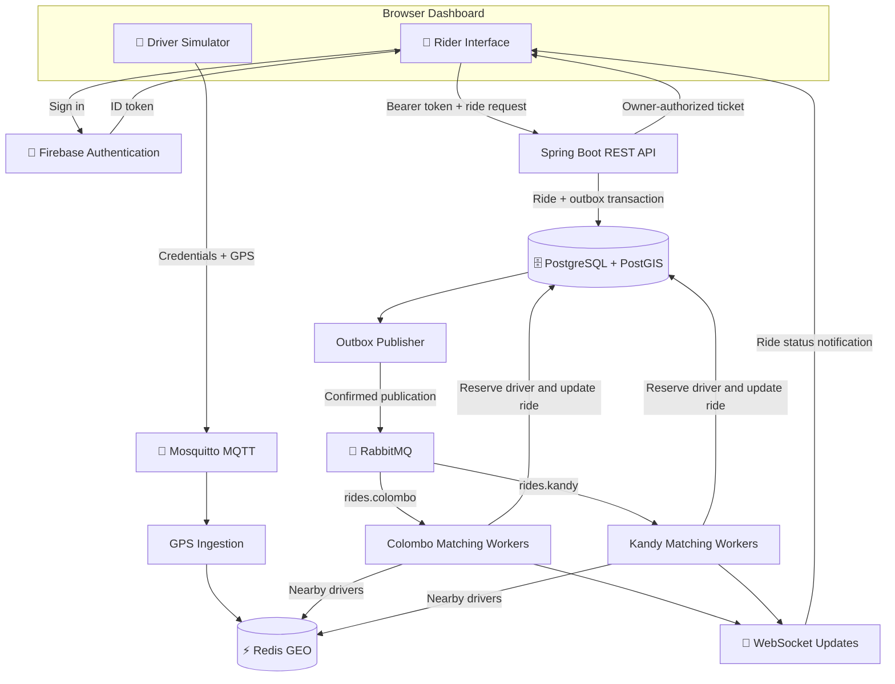
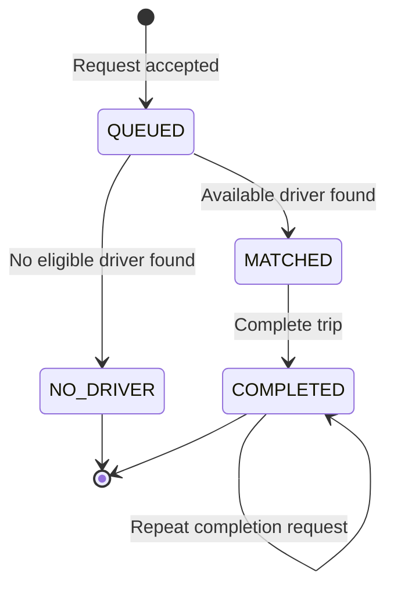
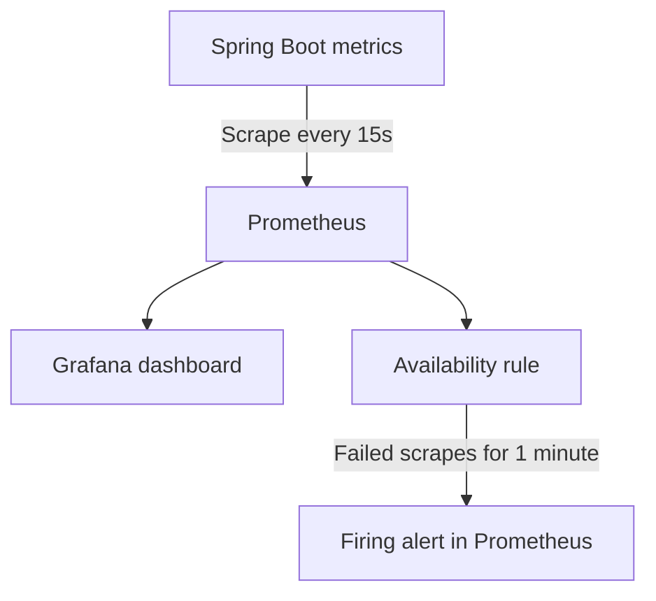

# 🚕 RideFlow

### Event-Driven Ride-Hailing Prototype

RideFlow is a local ride-hailing prototype that processes driver GPS updates and ride requests asynchronously. It combines Firebase authentication, database-controlled rider/driver permissions, MQTT messaging, city-specific queues, and Redis geospatial matching. The Spring Boot backend runs as one application with asynchronous workers; it is not a set of independently deployed microservices.

> 🎓 Learning and demonstration project. GPS is simulated, and payments do not charge real money.

---

## 📌 Project Status

The local demo includes ride matching, role-based access, mock payments, containerized infrastructure, monitoring, backup/restore scripts, and automated tests. Cloud deployment, real payments, TLS and autoscaling remain future work.

## ✨ Implemented Features

| Feature                    | Description                                                                  |
| -------------------------- | ---------------------------------------------------------------------------- |
| 🔐 Firebase Authentication | Email/password registration and login with backend JWT verification          |
| 📍 Driver GPS Simulator    | Publishes simulated coordinates through authenticated MQTT                   |
| 🛡️ MQTT Access Control     | Restricts provisioned drivers to their permitted location topics             |
| 📨 Asynchronous Processing | Buffers ride requests using RabbitMQ                                         |
| 🌆 City Queues             | Separate matching queues for Colombo and Kandy                               |
| ⚡ Geospatial Matching     | Searches Redis for nearby drivers within a 5 km radius                       |
| ⏱️ Location Freshness      | Excludes driver locations older than 30 seconds                              |
| 🚗 Driver Reservation      | Database constraints prevent simultaneous driver assignments                 |
| 🔄 Request Idempotency     | Repeated requests with the same key return the same ride                     |
| 📡 Live Updates            | Owner-authorized WebSocket tickets with polling fallback                     |
| 💳 Mock Payments           | Repeated payment calls return the existing payment receipt                   |
| 🗺️ Trip History            | Stores coarse pickup areas using PostgreSQL and PostGIS                      |
| 🔒 Location Minimization   | Clears precise pickup coordinates when a trip is completed                   |
| 💾 Ride Restoration        | Restores the selected ride after reloading the same browser tab              |
| 🩺 Health Checks           | Spring Boot Actuator reports infrastructure health                           |
| 📊 Metrics and Dashboards  | Prometheus metrics and provisioned Grafana panels                            |
| 🚨 Availability Alert      | Backend scrape-failure alert with verified recovery                          |
| 🧪 Automated Checks        | API, concurrency and Redis tests plus CI validation                          |
| 🐳 Backend Container       | Docker image build and Compose runtime                                       |
| 👥 Account Roles           | Database-controlled rider/driver permissions and role-based dashboard panels |
| 📍 GPS Validation          | Role, city, enabled-state, payload and retained-message checks               |
| 💽 Backup and Restore      | PowerShell backup and isolated restore verification scripts                  |

---

## 🏗️ Architecture



### How a ride is processed

1. A provisioned driver publishes GPS coordinates through MQTT.

2. The backend updates the driver's city-specific Redis location and last-seen timestamp.

3. An authenticated rider submits a request with an idempotency key.

4. The backend saves the ride and its outbox event in one database transaction.

5. The outbox publisher sends the event to the appropriate city queue.

6. A matching worker checks nearby, fresh driver locations.

7. The worker reserves an available driver and updates the ride.

8. The dashboard receives a notification and fetches the latest ride status.

9. Completing the ride releases the assignment and archives a coarse pickup area.

10. Mock payment retries return the existing receipt.

---

## 🔄 Ride Lifecycle



Payment is tracked separately from the ride status. A completed ride can receive a `MOCK_SUCCEEDED` payment record.

---

## 🧰 Technology Stack

| Layer                | Technology                                                                              |
| -------------------- | --------------------------------------------------------------------------------------- |
| Backend              | Java 17, Spring Boot 4.0.8                                                              |
| Authentication       | Firebase Authentication, Spring Security JWT verification                               |
| Driver Messaging     | MQTT, Eclipse Mosquitto, MQTT.js                                                        |
| Request Queues       | RabbitMQ, Spring AMQP                                                                   |
| Location Cache       | Redis geospatial indexes                                                                |
| Database             | PostgreSQL 16, PostGIS                                                                  |
| Live Updates         | WebSockets, HTTP polling fallback                                                       |
| Frontend             | HTML, CSS, JavaScript                                                                   |
| Local Infrastructure | Docker Desktop, Docker Compose                                                          |
| Build                | Maven Wrapper                                                                           |
| Monitoring           | Spring Boot Actuator, Micrometer, Prometheus, Grafana                                   |
| CI                   | GitHub Actions: backend tests, JAR packaging, Docker image build, Prometheus validation |

---

## 🚀 Local Setup — Windows PowerShell

### 1. Prerequisites

Install:

- Git

- Java 17 JDK

- Docker Desktop with the WSL 2 backend

- A code editor such as VS Code

A separate Maven installation is unnecessary because the backend includes Maven Wrapper.

### 2. Clone the repository

```powershell
git clone https://github.com/HasinduBimsara/rideflow.git
cd rideflow
```

### 3. Configure Firebase

Use your Firebase project configuration in the frontend authentication files and configure the backend JWT issuer and audience for the same project.

Enable **Email/Password** authentication in Firebase and configure the authorized domains used by your local application.

Firebase browser configuration identifies the project. It is separate from private service-account credentials and MQTT passwords.

### 4. Provision MQTT accounts

The broker uses a local password file:

```text
mosquitto/secrets/passwords
```

This file is ignored by Git and must be provisioned locally before starting the MQTT service.

Create:

- An `ingestion` account for the backend.

- A driver account whose username matches the driver's Firebase UID.

Use `mosquitto_passwd` to generate password hashes. Configure `mosquitto/acl.conf` so:

- `ingestion` can read `drivers/+/+/location`.

- Each driver can write only to its explicitly permitted city and UID topic.

Example driver topic:

```text
drivers/colombo/<FIREBASE_UID>/location
```

> MQTT accounts are provisioned manually. Registering a Firebase account does not automatically create an MQTT account. A fresh clone requires this local provisioning step.

### 5. Start the full Docker stack

Open Docker Desktop and wait for its engine to start. From the repository root, enter the password provisioned for the MQTT `ingestion` account:

```powershell
$secret = Read-Host "Enter ingestion MQTT password" -AsSecureString
$env:RIDEFLOW_MQTT_PASSWORD = [System.Net.NetworkCredential]::new("", $secret).Password
Remove-Variable secret
docker compose -f compose.yaml -f compose.backend.yaml -f compose.monitoring.yaml config --quiet
```

If validation succeeds, start the services:

```powershell
docker compose -f compose.yaml -f compose.backend.yaml -f compose.monitoring.yaml up -d --build
docker compose -f compose.yaml -f compose.backend.yaml -f compose.monitoring.yaml ps
```

The password variable applies to the current PowerShell session. Set it again when using a new terminal. Never commit MQTT passwords or the local password file.

### 6. Assign a driver role

After the backend has initialized `schema.sql`, provision a Firebase UID as a driver in `account_roles`. Driver promotion is a local administrator operation; the browser cannot grant itself a driver role.

```powershell
$driverUid = Read-Host "Enter the Firebase UID provisioned in the MQTT ACL"

if ($driverUid -notmatch '^[A-Za-z0-9_-]{1,100}$') {
    throw "UID is not supported by the current GPS simulator"
}

docker compose exec -T postgres psql -U ride -d rides -v ON_ERROR_STOP=1 -c "INSERT INTO account_roles (firebase_uid, role, enabled, driver_city) VALUES ('$driverUid', 'DRIVER', TRUE, 'colombo') ON CONFLICT (firebase_uid) DO UPDATE SET role = 'DRIVER', enabled = TRUE, driver_city = 'colombo';"
```

The database city must agree with the MQTT ACL. Authenticated accounts without an explicit role record default to `RIDER`. A role record with `enabled = FALSE` prevents ride API access and GPS ingestion. Keep rider and driver demo accounts separate.

### Optional native backend runtime

The backend runs in Docker with the stack above. Do not also launch a native backend on port `8081`.

For optional native Java development, the repository includes `start-backend.ps1`. Stop the Docker backend first and configure native Redis access to host port `16379`; Docker-to-Docker connections continue to use `redis:6379`.

### 7. Open the dashboard

Use one host consistently for login and dashboard access: `localhost` and `127.0.0.1` have separate browser authentication storage. After login, open `/` on that same host if the login page remains visible. Hard-refresh after rebuilding static files.

The account header shows `RIDER` or `DRIVER`. Riders see request/current-ride panels; drivers see the GPS simulator. **Refresh account permissions** reloads the database profile and stops active GPS publishing.

- Dashboard: http://localhost:8081/

- Login: http://localhost:8081/login.html

- Health: http://localhost:8081/actuator/health

---

## 🎮 Try the Demo

### 📍 Start driver GPS

1. Sign in with the Firebase account explicitly provisioned as a driver in both the database and MQTT broker.

2. Enter the MQTT password provisioned for that Firebase UID.

3. Select **Colombo**.

4. Keep the default driver coordinates:
   - Latitude: `6.9271`

   - Longitude: `79.8612`

5. Click **Start GPS**.

The role-based dashboard displays the driver's database-authorized city. Kandy publishing requires a corresponding Kandy driver role and MQTT ACL. A broker acknowledgment confirms broker acceptance; it does not itself confirm Redis ingestion.

### 🙋 Request a ride

Keep the driver GPS tab open. Open an Incognito/InPrivate window and sign in with a different rider account. Incognito tabs in the same private session share login state.

1. Select **Colombo**.

2. Enter pickup coordinates:
   - Latitude: `6.9280`

   - Longitude: `79.8620`

3. Click **New ride**.

4. An available, fresh nearby driver should produce `MATCHED`.

Without an eligible driver, the result is `NO_DRIVER`.

### ✅ Complete and pay

1. Click **Complete trip**.

2. Confirm the ride becomes `COMPLETED`.

3. Confirm precise pickup `lat` and `lon` become `null`.

4. Click **Mock pay / retry payment**.

5. Repeat the payment call and confirm the receipt remains unchanged.

### 💾 Reload the page

Reload the same tab after creating a ride. The dashboard restores the saved ride ID and fetches its current details through the authenticated API.

GPS publishing must be restarted manually after reload. Passwords and payment details are not restored automatically.

---

## 🔌 Ride API

Ride endpoints require a Firebase ID token and an enabled rider account:

```http
Authorization: Bearer <FIREBASE_ID_TOKEN>
```

| Method | Endpoint                        | Purpose                               |
| ------ | ------------------------------- | ------------------------------------- |
| `POST` | `/api/rides`                    | Create or retry a ride request        |
| `GET`  | `/api/rides/{id}`               | Read an owned ride                    |
| `POST` | `/api/rides/{id}/complete`      | Complete an owned matched ride        |
| `POST` | `/api/rides/{id}/pay`           | Create or retrieve a mock payment     |
| `POST` | `/api/rides/{id}/socket-ticket` | Obtain a short-lived WebSocket ticket |

Authenticated accounts can read their own profile using `GET /api/auth/account-profile`. Its response includes `uid`, `role`, `enabled`, and `driverCity`.

- Missing authentication on protected APIs: `401`.
- Authenticated driver or disabled account attempting a ride API: `403`.
- An eligible rider accessing another rider's ride: `404`.
- Reusing an idempotency key with changed request details: `409`.

Creating a ride also requires:

```http
Idempotency-Key: <UNIQUE_REQUEST_KEY>
```

Example request body:

```json
{
  "city": "colombo",
  "lat": 6.928,
  "lon": 79.862
}
```

The backend derives the rider identity from the verified token.

---

## 🛡️ Security and Privacy

- Firebase JWT verification protects ride and account-profile APIs.
- Database roles enforce rider API access, driver GPS ingestion and matching eligibility; hiding browser panels is only presentation.
- GPS ingestion rejects retained payloads, invalid coordinates and unauthorized driver/city combinations.

- Ownership checks restrict ride reads, completion, payment, and socket-ticket creation.

- WebSocket tickets are short-lived and single-use.

- MQTT anonymous connections are disabled.

- MQTT ACLs restrict driver publishing topics.

- Password files are excluded from version control.

- Local infrastructure ports are bound to loopback addresses.

- Precise pickup coordinates are cleared after trip completion.

- Mock payments do not collect or process card details.

> The local MQTT listeners use unencrypted connections. Production deployment requires TLS, secure secret management, and further security hardening. Coarse location data remains potentially sensitive.

---

## 🧪 Manually Verified Scenarios

| Scenario                                          | Observed Result                      |
| ------------------------------------------------- | ------------------------------------ |
| Valid driver MQTT credentials                     | GPS reaches Redis                    |
| Anonymous MQTT connection                         | Rejected                             |
| Driver publishes to another driver's topic        | Rejected with MQTT reason code `135` |
| Another user reads, completes, or pays for a ride | HTTP `404`                           |
| Another user requests a ride's socket ticket      | HTTP `404`                           |
| Same request key and payload                      | Existing ride returned               |
| Same request key with changed payload             | HTTP `409`                           |
| Repeated mock payment                             | Same receipt returned                |
| Trip completion                                   | Precise pickup coordinates cleared   |
| Matching listeners stopped                        | Request remains queued               |
| Matching listeners restarted                      | Queued request processed             |
| Dashboard reload in the same tab                  | Previous selected ride restored      |

The listener restart test verifies backlog processing after a temporary worker outage. It does not demonstrate an abrupt crash during an active transaction or a RabbitMQ storage failure.

---

## 🩺 Local Services

| Service              | Local Port                  |
| -------------------- | --------------------------- |
| RideFlow Backend     | `8081`                      |
| PostgreSQL / PostGIS | `5432`                      |
| Redis                | `16379` (container: `6379`) |
| RabbitMQ AMQP        | `5672`                      |
| RabbitMQ Management  | `15672`                     |
| MQTT TCP             | `1883`                      |
| MQTT WebSocket       | `9001`                      |
| Prometheus           | `9090`                      |
| Grafana              | `3000`                      |

Useful commands:

```powershell
# Show infrastructure status
docker compose -f compose.yaml -f compose.backend.yaml -f compose.monitoring.yaml ps
# Show MQTT logs
docker compose logs --tail=30 mqtt
# Inspect queue depth and consumers
docker compose exec -T rabbitmq rabbitmqctl list_queues -p / name messages_ready messages_unacknowledged consumers
# Stop infrastructure while retaining volumes
docker compose -f compose.yaml -f compose.backend.yaml -f compose.monitoring.yaml stop
```

---

## 📊 Monitoring and Alerts

Prometheus scrapes `/actuator/prometheus` every 15 seconds. Grafana loads the datasource and dashboard from version-controlled provisioning files.

| Dashboard panel                               | Meaning                                                                                                                |
| --------------------------------------------- | ---------------------------------------------------------------------------------------------------------------------- |
| Backend Status                                | Prometheus scrape availability: `1` means successful, `0` means failed; this is not a complete dependency-health check |
| Matching Results Since Backend Startup        | Completed matching attempts grouped by city and outcome (`MATCHED` or `NO_DRIVER`)                                     |
| Average Matching Processing Time              | Five-minute rate-based mean processing duration in milliseconds, excluding queue waiting time                          |
| Stale Locations Removed Since Backend Startup | Removed stale driver locations grouped by city                                                                         |

The average processing-time graph may be empty without recent matching attempts. Backend counters reset when the backend restarts.

- Grafana: http://localhost:3000 — open **RideFlow Monitoring**.

- Prometheus targets: http://localhost:9090/targets

- Prometheus alerts: http://localhost:9090/alerts

- Backend health: http://localhost:8081/actuator/health



`RideFlowBackendUnavailable` uses `up{job="rideflow-backend"} == 0` with `for: 1m`. It detects failed scrapes of the configured backend target, which can result from a backend outage or connectivity/metrics-endpoint failure. Email and other external notifications are not configured.

The stop-and-restart test was manually verified: **Inactive → Pending → Firing → Inactive**.

| File                                                         | Purpose                                    |
| ------------------------------------------------------------ | ------------------------------------------ |
| `compose.monitoring.yaml`                                    | Prometheus and Grafana services and mounts |
| `monitoring/prometheus/prometheus.yml`                       | Scrape and rule-file configuration         |
| `monitoring/prometheus/alerts.yml`                           | Backend availability alert                 |
| `monitoring/grafana/provisioning/datasources/prometheus.yml` | Prometheus datasource                      |
| `monitoring/grafana/provisioning/dashboards/dashboards.yml`  | Dashboard provider                         |
| `monitoring/grafana/dashboards/rideflow-monitoring.json`     | Dashboard panels and queries               |

UI dashboard edits do not update the JSON in Git. Export and update that file to preserve future dashboard changes in the repository.

## 🧪 Automated Tests and CI

GitHub Actions runs on pushes and pull requests to `main`, and supports manual execution.

- **Test and package backend:** starts disposable PostgreSQL/PostGIS, Redis, RabbitMQ and authenticated MQTT infrastructure; runs Maven `clean verify`; builds the backend Docker image.

- **Validate Prometheus configuration and alerts:** uses `promtool check config` and `promtool check rules` with Prometheus `v3.5.0`.

The current suite contains **41 tests**:

| Test class                 | Tests | Coverage                                                                               |
| -------------------------- | ----: | -------------------------------------------------------------------------------------- |
| `BackendApplicationTests`  |     1 | Application context                                                                    |
| `RideApiTests`             |    11 | Ownership, idempotency, completion, payments, role restrictions and permission changes |
| `MatchingConcurrencyTests` |     1 | Two simultaneous requests cannot reserve one driver twice                              |
| `MatchingRedisTests`       |     8 | Geospatial matching, stale/far locations and database driver eligibility               |
| `AccountProfileTests`      |     4 | Authentication, default rider, driver city and disabled profile                        |
| `LocationIngestionTests`   |     8 | GPS storage, role/city checks, invalid payloads and retained-message rejection         |
| `SocketTicketTests`        |     8 | Ticket API authentication/ownership, Redis TTL, single use and handshake rejection     |

Run the full suite from a terminal with the ingestion password configured and local services running:

```powershell
cd backend
$env:SPRING_DATA_REDIS_PORT = "16379"
.\mvnw.cmd clean verify
```

Local Redis uses host port `16379`; CI uses `6379` via its own environment. Check the final Maven result and latest CI run; test counts alone are not a success status.

Tests use real PostgreSQL/PostGIS and Redis where applicable, randomized fixture identities, SQL rollback or explicit cleanup, and isolated Redis keys for GPS tests. JWT-based API tests use test authentication and do not verify Firebase token cryptography. GPS ingestion tests invoke processing directly rather than validating broker login/ACL. Ticket tests invoke the handshake interceptor rather than opening a browser WebSocket. The expiry test forces a Redis ticket to expire without waiting a minute.

Prometheus CI checks validate configuration and rule syntax. The availability alert's firing and recovery were verified manually; CI does not currently simulate an outage. Building the Docker image does not publish or deploy it.

---

## 💽 Database Backup and Restore

Run these scripts from the repository root with PostgreSQL running:

```powershell
powershell.exe -NoProfile -ExecutionPolicy Bypass -File .\backup-db.ps1

powershell.exe -NoProfile -ExecutionPolicy Bypass -File .\test-restore-db.ps1 -BackupFile ".\backups\<BACKUP_FILENAME>.dump"
```

Replace `<BACKUP_FILENAME>` with a file produced by the backup script. Backups use PostgreSQL custom format and are stored under `backups/`, excluded by `/backups/` in `.gitignore`.

The restore script creates a uniquely named test database, restores the backup, queries ride/payment/trip-history counts and removes its temporary database. It does not overwrite `rides`. A successful manual restore previously returned 27 rides, 6 payments and 10 trip-history rows; these counts are an example, not fixed expected values for future backups.

This verifies that a backup can be restored and queried; it does not prove every business invariant or a complete disaster-recovery procedure. Store a separate protected backup copy off the laptop. No automatic backup schedule is configured.

## ✅ Final Local Demo Checklist

Run this after the latest code is built. These are verification steps, not claims that a fresh installation has already passed them.

- [ ] Full Maven suite reports 41 tests, zero failures/errors and `BUILD SUCCESS`.
- [ ] Latest GitHub Actions backend and monitoring-validation jobs are green.
- [ ] All seven Compose services are running: backend, PostgreSQL, Redis, RabbitMQ, MQTT, Prometheus and Grafana.
- [ ] Driver account shows only GPS controls; another rider account shows only ride controls.
- [ ] Driver starts GPS; a fresh Redis location and last-seen score appear.
- [ ] Rider creates a Colombo ride and receives `MATCHED` with the provisioned driver.
- [ ] Retrying the same request returns the same ride ID.
- [ ] Completion returns `COMPLETED`, clears precise coordinates and releases the assignment.
- [ ] Mock payment succeeds; repeating payment returns the same receipt.
- [ ] Grafana displays backend scrape status and matching activity.
- [ ] Backup script creates a nonempty file; restore script reports `Restore test passed`.
- [ ] `git status --short` is reviewed; backups and MQTT passwords are not tracked.

For a short demo recording, show login/roles, driver GPS, rider matching, completion/payment retry, the Grafana dashboard and the green CI run. Capture screenshots of both role views and the final results.

---

## ⚠️ Current Limitations

- This is a local prototype, not a production ride-hailing service.

- Driver roles, cities and MQTT credentials/ACLs are provisioned manually.
- Existing WebSocket tickets can remain valid for their short lifetime after a role change; handshake currently rechecks ride ownership, not role revocation. Existing connections are not forcibly disconnected by role changes.

- Matching uses geographic distance rather than road travel time.

- Separate city queues provide logical separation, but share backend and infrastructure resources.

- Payments are simulated; no payment gateway is connected.

- The frontend is a browser dashboard, not a React Native application.

- Automated scaling, cloud deployment, and multi-region failover are not implemented.

- Monitoring currently covers backend metrics and scrape availability; broader infrastructure monitoring and load testing remain future work.

- Availability alerts are displayed in Prometheus; external notification delivery is not configured.

---

## 🛣️ Roadmap

- [x] Separate rider and driver permissions

- [x] Add automated API, concurrency, and real Redis matching tests
- [x] Test GPS ingestion permissions and payload validation
- [x] Test WebSocket ticket ownership, expiration and single use
- [x] Add database backup and isolated restore verification scripts

- [x] Add matching processing-time and stale-location metrics

- [x] Provision a Grafana dashboard and backend availability alert

- [ ] Add queue-age metrics

- [x] Add CI checks with GitHub Actions

- [x] Containerize the backend

- [ ] Add TLS for MQTT and application traffic

- [ ] Integrate a payment gateway in test mode

- [ ] Add road-aware ETA matching

- [ ] Evaluate cloud deployment and autoscaling

- [ ] Build dedicated mobile clients

---

## 👨‍💻 Author

**Hasindu Bimsara**

Computing & Information Systems undergraduate

Sabaragamuwa University of Sri Lanka

- [GitHub](https://github.com/HasinduBimsara)

- [LinkedIn](https://www.linkedin.com/in/hasindubimsara/)

- [RideFlow Repository](https://github.com/HasinduBimsara/rideflow)
